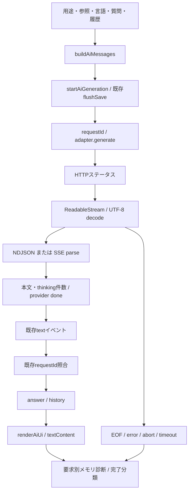

# AI診断基盤 Stage 1

対象 Issue #455。開始 main / HEAD `08572bb0f888c5e8b6f57f3c1aefe98fbf5d2e4d`、tree `bc6709ee93d44d8722ac653ef9cd960d99b93c03`。
根本原因 **UNKNOWN**。実Ollamaと実モデルは **PENDING_MANUAL**。以下は静的調査と架空応答のモック検証であり、翻訳品質・実モデルの安定性を保証しない。

## 処理経路と観測境界

診断のrequestIdはセッションUUID＋増分番号。既存の数値requestIdによるUIへの遅延応答拒否は変更しない。診断callbackは各要求に閉じ、adapterの本文・オプション・ネットワークpayloadへ診断IDを追加しない。HTTP成功は生成成功と同一視しない。

`receivedChunks` はreader.readのdone=false回数（空Uint8Arrayを含む）。`bodyChunks` は本文のあるパース済みイベント数、`bodyCharacters` はその文字数。JavaScript UTF-16 code unitで統一する。Ollamaのthinkingはmessage.thinkingの文字列だけを計数。Geminiは最初のcandidateのthought=true partを別計数し、本文はthought以外のpart。Geminiの本文計数は既存の累積テキスト重複除去より前なので、最終回答文字数と異なる場合がある。

Ollamaはevent.done、Geminiはcandidate.finishReasonをプロバイダ完了通知とする。GeminiアダプタがEOF後に合成するtype=doneは証拠に数えない。重複doneはdoneCountで分かる。streamEndedNormallyはtransport EOFの観測であり、末尾JSON解析の成功を意味しない（EOF後に不完全JSONならERROR）。本文確定、UIへのtextContent反映、transport EOFは別欄。UI文字数は回答表示欄に反映した本文だけで、プレースホルダーを除く。実際の画面paintや可視性はこの値では証明しない。

優先順位はTIMEOUT → INTERRUPTED（abortedまたは旧要求）→ ERROR → EOF未観測UNKNOWN → doneなしSTREAM_ENDED_WITHOUT_DONE → 本文と最終回答ありCOMPLETED_WITH_TEXT → COMPLETED_EMPTY。thinking-onlyを本文成功にしない。Geminiがthoughtテキストを既存回答へ含める場合も診断は本文なしと区別する。

## コード上の事実と原因候補

|事実・候補|根拠|判定と次の観測|
|---|---|---|
|空回答で完了表示|startAiGenerationはiterator正常終了後に本文・doneを確認せずCOMPLETEDへ遷移|コード上確認、空doneモックで再現。Stage 1では表示変更なし|
|完了通知なしでも完了表示|同上。Ollamaはdoneを強制せずEOFまで読む|コード上確認、欠doneを別分類|
|thinking-onlyで表示本文なし|Ollamaはcontent/responseのみyieldする|コード上確認、thinkingのみを空完了として診断|
|Gemini thoughtが回答に入る|extractGeminiEventは全text partを連結する|既存挙動として保持。Stage 2修正候補、実モデル影響UNKNOWN|
|翻訳への会話履歴の影響|buildAiMessagesは全用途で同じhistoryを挿入|混入構造は確認、誤翻訳との因果UNKNOWN|
|空assistantの履歴表示|renderAiChatHistoryは空assistantに「生成中…」を表示する|正常EOF後も空ならその表示が残り得る。Stage 2候補|
|古い応答の混入|既存数値requestIdチェックがtext反映前にある|reset後の遅延モックは新要求/UIへ混入せず。全競合の証明ではない|
|送信前save待ち中のUI・設定変更|messages組立後にawait flushSave、その後model/用途等を読む|モデルとmessages作成時の用途が異なり得る。今回は組立時purpose/languageと送信時uiPurpose/uiTranslationLanguageを分離記録。競合修正は未実装|
|モデル/プロンプト依存、Ollama本体、描画遅延|実モデル比較証拠なし|UNKNOWN、手動A/B比較へ|

## messages比較

参照がある条件では順序は共通で、system設定 → system参照資料 → 過去user/assistant → 今回user。参照なしでは参照systemを省略。system設定が空の場合はそのsystemも省略される。参照本文は資料として扱う指示付きだがsystem roleで送る既存仕様を維持。

|条件|送信構造（system設定・参照あり、履歴は1往復）|最終user|
|---|---|---|
|A 翻訳・履歴なし|system, system, user|翻訳先言語入りタスク＋追加指示|
|B 翻訳・履歴あり|system, system, user, assistant, user|同上。過去の回答が先行する|
|C 自由質問・履歴なし|system, system, user|質問文字列のみ|
|D 自由質問・履歴あり|system, system, user, assistant, user|質問文字列のみ|

指示のroleと順序は確認できるが、実モデルが実際にどの指示へ従うかはUNKNOWN。自由質問ではquestion preset.templateを最終userへ含めない既存仕様。モックはA〜D×日本語/英語の8条件で実adapterへ渡るmessagesと文字数・履歴件数を照合する。モデル変更時も会話を保持する既存動作を確認する。

設定は既存normalizeAiSettings/withAiProviderSettings、localStorageの既存キーと保存/読込みを維持。診断ON/OFFはセッション内のみで、保存形式に追加しない。

## プライバシーと保持

- 本文、質問、回答、thinking、参照ID/題名、APIキー、URL、例外message/stackを保存しない。入力は数・列挙値・制限されたモデル識別子へ投影し、任意フィールドを捨てる。messagesは最大128個のroleのみを記録し、省略フラグを付ける。
- モデル名は最大200文字の識別子に制限し、既知APIキーと一致/包含する場合はREDACTED。名前自体に機密情報を付けないこと。通常のカスタムモデル識別子はコピーに含まれるため、共有前に確認する。
- このタブのメモリ内のみ、最大20件・30分・JSON UTF-8 64KiB。読み書き時に上限を検査し、期限timerでも削除。コピーは同じsnapshotのJSON。外部送信・永続保存なし。オフ/消去で古いhandleも無効化し、再オンで復活しない。
- 大きな生イベントログや本文exportは実装しない。生データ取得は利用者が後日、架空fixtureについて明示操作する場合に限る。
- 診断callbacksの例外は通信層で隔離。正常な要求payload、既存yield、既存公開生成stateは変更しない。

## 検証

`node --test ai-diagnostics.test.js ai-context.test.js ai-prompts.test.js ai-provider.test.js ai-reference-selection.test.js ai-ui.test.js ollama-adapter.test.js gemini-adapter.test.js version.test.js`

診断テストは実アダプタを架空fetch/readerで動かし、app.jsから実生成・描画・reset・panel関数を抽出したVMで要求分離とDOM textContentを確認する。DOMは最小モックでありブラウザ実画面ではない。連続2回/5回、欠done、重複done、空、thinking、不完全JSON、切断、停止、timeout、古い遅延応答、ON/OFF、秘密非混入、保持上限を含む。最終集計と独立レビューはREPORT.mdを参照。

## ロードマップ（提案）

1. Stage 1：今回のメタデータ診断・連続モック・再現手順。実モデルの根本原因はUNKNOWN。
2. Stage 2：手動比較の証拠を得てから、空/欠doneの利用者表示、thinkingの分離、save待ち競合、翻訳履歴の分離、要求状態機械・timeout境界を個別反例で安定化する。
3. Stage 3：用途別履歴、翻訳比較、モデル能力表示などの拡充を検討する。明示操作による保存を維持する。

Stage 2/3は今回実装しない。Codex連携・メモ保存・IndexedDB・Worker・MCP・安全停止・自動上書きに変更なし。
